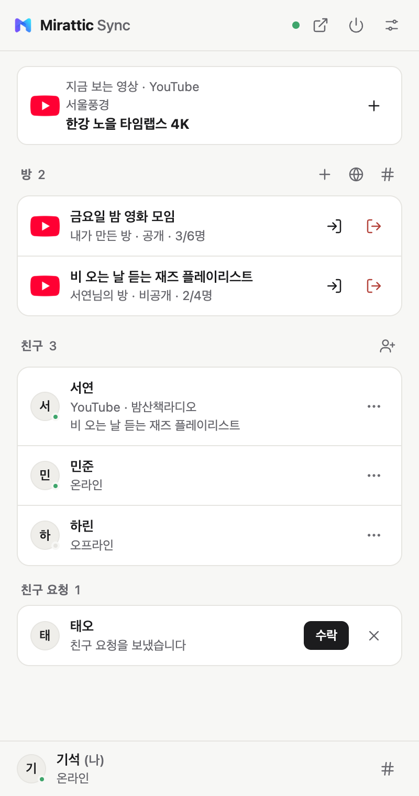
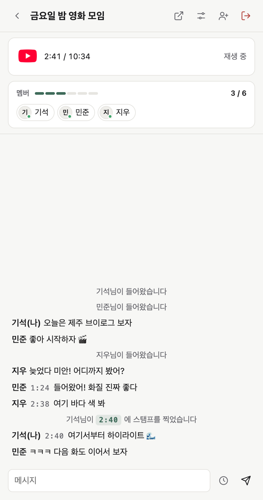
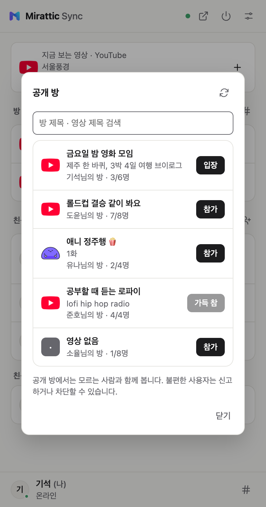
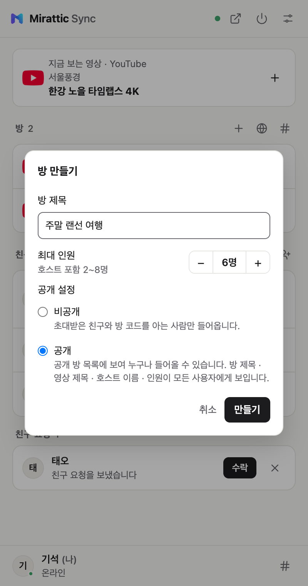
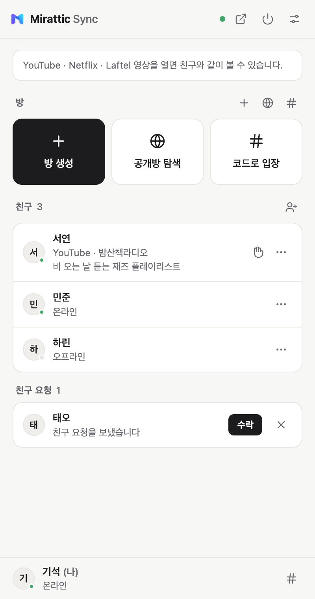
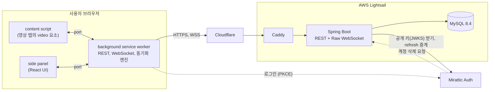

# Mirattic Sync

친구가 지금 무슨 영상을 보는지 확인하고, 그 방에 들어가 같은 장면을 같은 초에 보면서 옆에서 이야기하는 Chrome 확장입니다.

영상은 각자 자기 브라우저에서, 자기 계정으로 틉니다. 방 사람들끼리 맞추는 건 "지금 몇 초, 재생 중인지, 속도는 얼마인지" 같은 재생 정보뿐이고, 영상 자체는 Sync를 거치지 않습니다.

[Chrome 웹 스토어](https://chromewebstore.google.com/detail/ffoifpjldcgdiipbhljkofgifmefgohk) | [sync.mirattic.com](https://sync.mirattic.com) | [패치 노트](https://sync.mirattic.com/patch-notes.html)

| | |
| --- | --- |
| 서버 | Java 21, Spring Boot 4.1, Spring Security(OAuth2 Resource Server), JPA, Raw WebSocket, Flyway |
| 확장 | Chrome MV3(WXT), TypeScript, React, pnpm workspace |
| DB | MySQL 8.4 |
| 인증 | [Mirattic Auth](https://github.com/G1Se0k/mirattic-auth) (OAuth 2.0 / OIDC) |
| 인프라 | AWS Lightsail, Cloudflare, Caddy, Docker Compose, GitHub Actions |
| 규모 | REST 엔드포인트 53개, 테이블 10개, 테스트 서버 97개 / 클라이언트 195개 |

## 화면

실제 UI 컴포넌트(`packages/ui`)에 예시 데이터를 넣고 찍은 화면입니다.

| 메인 | 방 | 공개 방 목록 |
| :---: | :---: | :---: |
|  |  |  |

| 방 만들기 | 처음 열었을 때 |
| :---: | :---: |
|  |  |

방장이 재생하거나 멈추거나 넘기면 다른 사람들 화면이 따라갑니다. 재생 속도를 바꿔도 따라가고, YouTube 광고가 나오는 동안에는 잠깐 멈춥니다.
친구 목록에서는 친구가 뭘 보고 있는지 보이고(얼마나 보여줄지는 각자 설정), 거기서 바로 합류를 요청할 수 있습니다.
방은 초대, 방 코드, 공개 방 목록으로 들어오고 최대 8명까지 함께 봅니다. 채팅에 영상 위치를 붙여 두면 방장이 눌러서 그 장면으로 갈 수 있습니다.

지원 사이트는 YouTube이고, Netflix와 Laftel은 실험 기능으로 기본은 꺼져 있습니다.

## 구조



```text
apps/extension     확장 (background 엔진, 사이트별 content script, side panel)
packages/sync-core 동기화 엔진 (서버 시계 추정, drift 처리)
packages/client    REST / WebSocket 클라이언트
packages/ui        side panel 화면
packages/types     공통 타입
server             Spring Boot 서버
```

동기화 엔진은 패널이 아니라 background service worker에 있습니다. 그래서 패널을 닫아도 방은 계속 맞춰집니다.
사이트마다 다른 부분(플레이어를 찾고, 재생하고, 위치를 읽는 일)은 사이트별 adapter 안에만 있고, 엔진은 재생, 일시정지, 이동, 속도 바꾸기, 현재 상태 읽기 같은 공통 동작만 부릅니다.

서버에는 영상이나 소리가 지나가지 않습니다. DB에 저장하는 건 방의 재생 상태와 방에서 보는 영상 정보(영상 ID, 제목, URL), 그리고 계정, 친구, 방, 채팅, 신고 데이터입니다. 친구 목록에 보여 줄 "지금 보는 영상" 정보(사이트, 영상 ID, 제목, 채널, URL, 썸네일 주소)는 서버 메모리에만 잠깐 두고, 연결이 끊기면 지웁니다.

설계하면서 내린 결정 112개는 이유와 함께 [`docs/architecture/plan.md`](docs/architecture/plan.md)에 모아 두었습니다. 프로토콜은 [REST](docs/protocol/rest.md), [WebSocket](docs/protocol/websocket.md) 문서에 있습니다.

## 고민했던 것들

### 시계가 다른 브라우저끼리 같은 초 맞추기

처음 부딪힌 문제는 사람마다 PC 시계가 다르다는 점이었습니다. "방장이 2:40에서 재생했다"는 정보만 받으면, 그게 언제였는지를 각자 자기 시계로 계산하게 되고 몇백 ms씩 어긋납니다.

그래서 모두가 서버 시계를 기준으로 삼게 했습니다. 클라이언트가 서버와 몇 번 핑퐁을 하면서 왕복 시간의 절반만큼 늦게 받았다고 보고 서버와의 시차를 계산합니다. 최근 8번 중 왕복이 가장 빨랐던 값만 믿는데, 네트워크가 막혔을 때 생기는 지연은 오차를 키우기만 하기 때문입니다.
방장은 명령에 "서버 시각으로 언제" 찍었는지를 같이 보내고, 멤버는 그 시각부터 지금까지 흐른 시간만큼 더해서 지금 있어야 할 위치를 구합니다.

위치가 어긋났을 때 바로바로 seek하면 버퍼링 때문에 잠깐 밀린 것까지 건드려서 영상이 계속 튑니다. 그래서 차이 크기에 따라 다르게 다룹니다.

| 차이 | 처리 |
| --- | --- |
| 0.5초 미만 | 그냥 둠 |
| 0.5~1.5초 | 평소엔 그냥 둠. 방장이 막 바꿨거나 우리가 막 seek한 직후, 플레이어가 늦게 도착하는 동안만 맞춤 |
| 1.5~3초 | 방장이 막 바꿨으면 바로, 아니면 한 번 더 확인하고 그래도 어긋나 있으면 seek |
| 3초 넘게 | 바로 seek |

재생/정지 상태와 속도는 위치보다 먼저 맞춥니다. 속도가 다르면 위치는 계속 다시 벌어지기 때문입니다.
Netflix는 공개 API가 아니라 플레이어 내부 기능으로 이동하는데, 이게 동작하지 않을 때는 seek 대신 멤버에게 몇 초로 직접 옮기라고 안내합니다.

### 서버 제한 때문에 오히려 어긋나던 문제

방장이 시크바를 끌면 명령이 짧은 간격으로 쏟아집니다. 처음엔 서버에서 "명령 사이 최소 간격"을 두고 너무 빨리 온 건 버렸는데, E2E 테스트를 돌려 보니 멤버가 계속 엉뚱한 위치에 남아 있었습니다.
네트워크 지터로 명령 몇 개가 붙어서 도착하면, 하필 제일 중요한 마지막 명령이 버려지고 있었던 겁니다.

그래서 방향을 바꿨습니다. 클라이언트가 200ms 동안 명령을 모아 마지막 상태만 보내고, 서버는 초당 20회라는 넉넉한 한도만 둡니다. 그 뒤로 최소 간격 때문에 마지막 명령이 버려지던 문제는 사라졌습니다.

### 방 상태를 메모리가 아니라 DB에 둔 이유

재생 상태에는 version이 붙어 있고, 클라이언트는 자기가 아는 것과 같거나 작은 version이 오면 옛날 정보로 보고 버립니다. 그런데 이걸 메모리에 두면 서버가 재시작될 때 version이 0으로 돌아가고, 클라이언트는 그 뒤로 오는 상태를 계속 버리게 됩니다.

그래서 재생 상태와 version을 `rooms` 행에 저장하고, 명령이 올 때마다 그 행을 비관적 잠금으로 잡도록 했습니다. 같은 방에 명령이 몰려도 순서가 섞이지 않고, 재시작 뒤에도 version이 이어집니다.
반대로 누가 지금 접속해 있는지처럼 금방 바뀌고 잃어도 되는 값은 메모리에만 둡니다.

동시에 일어나면 꼬이는 흐름도 몇 군데 있었습니다. 합류 요청, 그 요청에 대한 응답, 공개 방으로 바로 들어가기가 겹치면 요청이 열린 채로 이미 방에 들어가 있는 상태가 생길 수 있어서, 이 셋은 같은 잠금 안에서 처리합니다.

### WebSocket은 STOMP 없이

이벤트 종류가 많지 않아서 `{ type, payload }` 형태의 JSON을 그대로 주고받는 Raw WebSocket으로 만들었습니다. 몇 가지 정해 둔 규칙이 있습니다.

access token을 URL에 넣지 않으려고, 연결할 때는 REST로 30초짜리 일회용 티켓을 받아서 씁니다.
계정당 연결은 하나만 둡니다. 다른 기기에서 접속하면 기존 연결에 알리고 닫습니다.
Cloudflare는 100초 동안 조용한 WebSocket을 끊어서, 서버가 30초마다 ping을 보냅니다.
친구 목록이나 방이 바뀌면 무엇이 바뀌었는지는 보내지 않고 "다시 읽어 가라"는 신호만 보냅니다. 변경분을 맞추는 코드를 따로 짤 필요가 없어서 편했습니다.

### 인증은 직접 만들지 않았습니다

처음엔 Sync 안에 가입, 로그인, JWT 발급이 다 있었습니다. Sync와 Flow가 같은 계정을 쓰게 하려고 인증을 [Mirattic Auth](https://github.com/G1Se0k/mirattic-auth)로 떼어냈습니다.
지금 Sync 서버에는 비밀번호도 JWT 서명 키도 없습니다. Auth가 발급한 토큰을 공개 키(JWKS)로 검증하기만 합니다.

확장은 `chrome.identity.launchWebAuthFlow`로 로그인 창을 엽니다. 서버가 code를 토큰으로 바꾼 다음, 토큰을 URL에 싣지 않으려고 60초짜리 일회용 코드로 한 번 더 감싸서 확장에 넘깁니다.

### 하지 않기로 한 것들

영상 서비스와 관련해서는 처음부터 선을 그어 두었습니다. 영상을 중계하거나 저장하지 않고, DRM이나 지역 제한, 동시 시청 제한을 우회하지 않고, 스트리밍 서비스의 비밀번호나 쿠키를 받지 않습니다.
사이트를 붙이기 전에는 그때의 약관과 정책을 확인해서 [`docs/platform-policy/`](docs/platform-policy/)에 날짜와 함께 적었고, 아직 확인하지 못한 부분(Laftel 약관 원문 등)도 그대로 적어 두었습니다.

해석이 애매하면 조심스러운 쪽을 골랐습니다. 방장이 다른 시리즈의 영상으로 넘어가면 멤버에게 먼저 묻고, 광고 중에는 명령을 보내지 않고, Netflix와 Laftel은 사용자가 직접 켜야 동작합니다.
확장 권한도 필요한 것만 받습니다. side panel, 저장소, 로그인 창(identity), 실험 사이트를 켰을 때 그 탭에 스크립트를 넣는 권한(scripting)과 지원 사이트 주소가 전부입니다.

## 동시 접속은 어디까지 버틸까

동시 접속을 직접 재 보려고 [`loadtest/run.mjs`](loadtest/run.mjs)를 만들었습니다. 4명짜리 방을 단계적으로 늘리면서, 방장은 5초마다 일시정지를 보내고 모두 15초마다 채팅합니다. 다른 멤버가 메시지를 받기까지 걸린 시간과 빠진 메시지를 셉니다.

| 환경 | 동시 접속 | p95 | p99 | 손실 |
| --- | ---: | ---: | ---: | --- |
| M3 Max (부하 생성기와 같은 기기) | 5,000 | 10ms | | 0 |
| M3 Max (부하 생성기와 같은 기기) | 8,000 | 73ms | 269ms | 0 |
| Mac mini M4 (당시 운영 서버, 메모리 2GB 제한) | 3,000 | 49ms | 221ms | 0 |

Mac mini는 5,000 연결로 올리다가 무너졌습니다. CPU는 15~30%밖에 안 썼는데 메모리가 2GB 한도에 붙어 있었습니다.
그래서 연결 하나가 메모리를 얼마나 먹는지 따로 쟀습니다. GC 뒤 힙을 단계마다 보니 연결당 약 110KB였고, 그중 Tomcat의 텍스트 메시지 버퍼가 33KB, 소켓과 프레임 버퍼가 44KB였습니다.
이걸로 "고정 0.9GB + 연결 수 × 110KB × 2(GC 여유)"라는 대략적인 계산식을 세워 두었습니다.

## 테스트와 배포

서버 테스트 97개는 대부분 Testcontainers로 MySQL을 띄워서 돌리는 통합 테스트입니다. 방과 친구 흐름, 잠금 순서, 차단하거나 강퇴된 사람이 방을 못 보는지, 페이지 경계, 예전 버전 확장이 보내는 요청까지 확인합니다. 클라이언트 195개는 Vitest로 동기화 엔진과 확장 background를 검증합니다.
변경은 보통 다른 모델(OpenAI Codex)에게 리뷰를 받고 넣었고, 어떤 리뷰를 거쳤는지는 커밋 메시지와 [`docs/progress.md`](docs/progress.md)에 남겨 두었습니다.

main에 푸시하면 GitHub Actions가 테스트를 돌리고, 서버 코드나 배포 스크립트, CI 설정이 바뀌었을 때만 이미지를 만들어 SSH로 서버에 보냅니다. 레지스트리는 쓰지 않습니다.
서버의 `deploy.sh`가 새 이미지로 바꾼 뒤 헬스 체크에 실패하면 이전 이미지로 되돌립니다. DB는 매일 새벽 4시에 덤프해서 7일치를 남깁니다.
처음엔 집에 있는 Mac mini에서 돌렸고, 2026년 10월 3일에 AWS Lightsail로 옮겼습니다.

## 로컬에서 돌리기

Node 22, pnpm, Java 21, Docker가 필요합니다. [Mirattic Auth](https://github.com/G1Se0k/mirattic-auth)를 local 프로파일로 먼저 띄워 두세요.

```sh
pnpm install

# 확장 (chrome://extensions에서 apps/extension/.output/chrome-mv3를 압축해제된 확장으로 로드)
# 로그인 쿠키 때문에 서버와 같은 호스트(127.0.0.1)를 씁니다
VITE_API_URL=http://127.0.0.1:8080 pnpm --filter @mirattic/extension dev

# 서버
docker compose up -d mysql
cd server && AUTH_ISSUER=http://127.0.0.1:9000 AUTH_CLIENT_SECRET=dev-sync-secret \
  AUTH_REDIRECT_URI=http://127.0.0.1:8080/auth/callback ./mvnw spring-boot:run
```

<details>
<summary>서버 환경변수</summary>

| 변수 | 필수 | 설명 |
|---|---|---|
| `AUTH_CLIENT_SECRET` | ✅ | Mirattic Auth의 `mirattic-sync` client secret. 없으면 서버가 뜨지 않습니다 |
| `AUTH_ISSUER` | | 기본 `https://auth.mirattic.com` |
| `AUTH_REDIRECT_URI` | | 기본 `https://sync.mirattic.com/auth/callback` |
| `AUTH_EXTENSION_REDIRECTS` | | 로그인 후 돌아갈 확장 주소 (기본 `https://ffoifpjldcgdiipbhljkofgifmefgohk.chromiumapp.org/`) |
| `DB_URL`, `DB_USERNAME`, `DB_PASSWORD` | | 기본값은 docker-compose 로컬 개발용 |
| `ALLOWED_ORIGINS` | | CORS/WebSocket 허용 origin (쉼표로 구분). 기본은 확장 ID |

</details>

```sh
pnpm typecheck && pnpm test && pnpm build
cd server && ./mvnw test
```

## 다른 저장소

- [mirattic-main](https://github.com/G1Se0k/mirattic-main): 전체 구성과 mirattic.com
- [mirattic-auth](https://github.com/G1Se0k/mirattic-auth): 계정과 로그인을 맡는 인증 서버
- [MiratticFlow](https://github.com/G1Se0k/MiratticFlow): 팀 협업, 이슈 관리
