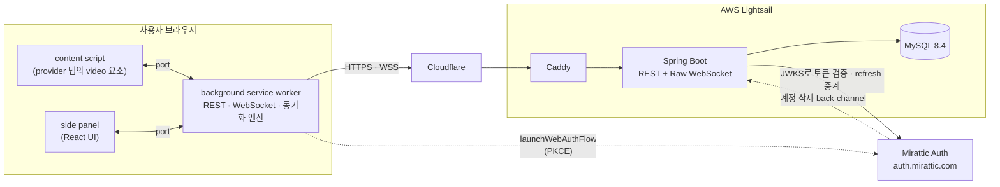
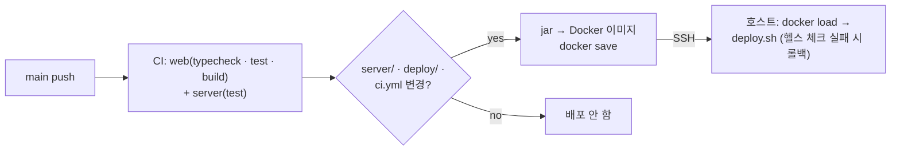

# Mirattic Sync

친구가 지금 보는 영상을 확인하고, 합류해서 **같은 장면을 같은 초에** 보며 옆에서 대화하는 소셜 워치파티 Chrome 확장입니다.
영상은 각자 자기 브라우저에서 자기 계정으로 재생하고, Mirattic은 **재생 메타데이터(위치 · 재생/정지 · 속도)만** 동기화합니다.

**🔗 [Chrome 웹 스토어](https://chromewebstore.google.com/detail/ffoifpjldcgdiipbhljkofgifmefgohk) · [sync.mirattic.com](https://sync.mirattic.com) · [패치 노트](https://sync.mirattic.com/patch-notes.html)**

| | |
| --- | --- |
| 백엔드 | Java 21 · Spring Boot 4.1 · Spring Security(OAuth2 Resource Server) · Spring Data JPA · Raw WebSocket · Flyway |
| 클라이언트 | Chrome MV3 확장(WXT) · TypeScript · React · pnpm workspace |
| 데이터베이스 | MySQL 8.4 |
| 인증 | [Mirattic Auth](https://github.com/G1Se0k/mirattic-auth) (OAuth 2.0 / OIDC, RS256 JWT + JWKS) |
| 인프라 | AWS Lightsail · Cloudflare · Caddy · Docker Compose · GitHub Actions |
| 규모 | REST 엔드포인트 53개 · 테이블 10개(Flyway V1–V27) · 서버 테스트 97개 · 클라이언트 테스트 195개 |

---

## 화면

실제 UI 컴포넌트(`packages/ui`)에 예시 데이터를 넣어 렌더링한 화면입니다.

| 메인 | 방 (재생 상태 · 채팅) | 공개 방 목록 |
| :---: | :---: | :---: |
|  |  |  |

| 방 만들기 | 첫 화면 |
| :---: | :---: |
|  |  |

## 기능

- **재생 동기화** — 호스트가 재생 · 일시정지 · 이동 · 속도를 바꾸면 멤버의 플레이어가 따라갑니다. YouTube 광고 중에는 동기화를 멈춥니다
- **친구 · 상태 공유** — 친구 코드로 추가, 친구가 보는 영상 표시(공개 범위는 직접 설정), 보는 영상에 합류 요청
- **방** — 초대장 · 방 코드 · 공개 방 목록으로 입장, 방 제목 · 인원(2–8명) · 공개 여부 설정, 강퇴 · 호스트 위임
- **채팅** — 사이드 패널 채팅, 영상 위치가 붙는 타임스탬프(호스트가 누르면 그 위치로 이동), 입퇴장 기록
- **안전** — 차단 · 신고 · 계정 삭제, 브라우징 활동 수집 전 동의 화면
- **지원 사이트** — YouTube, Netflix(실험) · Laftel(실험): 실험 사이트는 기본 꺼짐, 켤 때 위험을 안내합니다

## 아키텍처



```text
apps/extension     WXT (Chrome MV3) — background(엔진) · content script(provider별 adapter) · side panel
packages/types     공통 타입 (PlaybackState, WebSocket envelope, MediaProviderAdapter, REST DTO)
packages/client    REST + WebSocket 클라이언트 (토큰 갱신, 재연결)
packages/sync-core 동기화 엔진 (서버 시계 추정, drift 정책, SyncFollower, 호스트 명령 묶기)
packages/ui        side panel 화면 (React)
server             Spring Boot — friend · presence · room · ws · report · account 도메인 패키지
```

- **영상 · 음성은 서버를 지나지 않습니다.** 서버가 다루는 것은 재생 상태(`{ positionMs, playing, rate, capturedAt, version }`), 보고 있는 영상의 메타데이터(사이트 · 영상 ID · 제목 · 채널 · URL · 썸네일 주소, 공개 범위 설정에 따라 친구에게 보임), 그리고 계정 · 친구 · 방 · 채팅 · 신고 데이터입니다.
- **확장의 엔진은 background service worker에 있습니다.** 패널을 닫아도 방 동기화가 계속되고, 패널 · content script는 port로 엔진에 붙습니다.
- **provider별 코드는 adapter 하나에 격리했습니다.** 엔진은 `MediaProviderAdapter`(play · pause · seek · snapshot)만 알고, 사이트별 DOM · 플레이어 차이는 adapter 안에 있습니다.

설계 결정 112개와 그 이유는 [`docs/architecture/plan.md`](docs/architecture/plan.md), 프로토콜은 [REST](docs/protocol/rest.md) · [WebSocket](docs/protocol/websocket.md) 문서에 있습니다.

---

## 주요 기술 결정

### 1. 시계가 다른 브라우저들을 서버 시각 하나로 맞춘다

멤버마다 PC 시계가 몇백 ms씩 다르기 때문에 "호스트가 2:40에 재생했다"만으로는 위치를 맞출 수 없습니다.

- 클라이언트는 `sync:request` / `sync:response` 왕복으로 **서버 시계 offset을 추정**합니다(`ServerClock`). 지연이 대칭이라고 보고 RTT/2 시점의 서버 시각을 쓰며, 최근 8개 표본 중 **RTT가 가장 짧은 표본**을 믿습니다. 큐잉 지연은 오차를 늘리기만 하기 때문입니다.
- 호스트 명령의 `capturedAt`은 호스트가 추정한 **서버 시각**입니다. 멤버는 `positionMs + (서버 지금 − capturedAt) × rate`로 지금 있어야 할 위치를 계산합니다.

### 2. drift는 구간별로 다르게 고친다

차이가 날 때마다 seek하면 버퍼링 같은 일시적 차이에도 영상이 계속 튑니다. 그래서 차이 크기에 따라 다르게 처리합니다(`classifyDrift`).

| 차이 | 처리 |
| --- | --- |
| 0.5초 미만 | 무시 |
| 0.5 – 1.5초 | 허용 (새 호스트 상태나 우리 seek 직후, 플레이어가 늦게 도착하는 동안에만 맞춤) |
| 1.5 – 3초 | 호스트 이벤트 직후면 즉시, 그 밖에는 **한 번 더 확인한 뒤에도 남아 있으면** seek |
| 3초 초과 | 항상 즉시 seek |

재생/정지 불일치와 속도는 위치보다 먼저 바로잡습니다. 속도가 다르면 그 자체가 drift를 만들기 때문입니다.
프로그램이 일으킨 seek이 다시 이벤트를 발생시키는 echo loop는 억제 창을 두지 않고, 재확인에서 차이 0으로 끝나는 구조로 막았습니다.

### 3. 호스트 명령은 묶어서 보내고, 서버는 초당 20회로 제한한다

처음에는 서버에 "최소 간격" 제한을 두었는데, E2E 테스트에서 **지터 때문에 붙어 온 마지막 명령이 버려져 멤버가 계속 어긋나는** 문제가 드러났습니다.
클라이언트가 200ms 단위로 명령을 모아 마지막 상태만 보내고, 서버는 초당 20회 한도만 두는 방식으로 바꿨습니다.

### 4. 방 상태는 DB 행에 두고, 명령마다 행을 잠근다

재생 상태와 `version`을 서버 메모리가 아니라 `rooms` 행에 저장하고, 명령마다 `PESSIMISTIC_WRITE`로 잠급니다.
서버가 재시작돼도 `version`이 줄지 않아야 클라이언트가 새 상태를 "오래된 것"으로 버리지 않기 때문입니다.
반대로 접속 여부(presence)처럼 휘발성인 데이터는 메모리에만 둡니다.

동시에 일어나면 꼬이는 흐름은 잠금 순서를 정해 직렬화했습니다.
- 합류 요청 · 응답 · 공개 방 바로 입장: 같은 잠금 안에서 처리해, 요청이 열리는 동시에 방에 들어가는 경우를 막습니다.
- 신고 하루 20건 한도: 신고자 `users` 행을 잠가 동시 요청으로 한도를 넘지 못하게 합니다.

### 5. WebSocket은 직접 만든 얇은 프로토콜로

STOMP 없이 `{ type, payload }` JSON envelope을 쓰는 Raw WebSocket입니다. 클라이언트 라이브러리가 필요 없고 이벤트 이름이 문서와 1:1로 대응합니다.

- **인증:** access token을 URL에 넣지 않기 위해 `POST /api/ws-ticket`으로 **30초짜리 일회용 티켓**을 받아 핸드셰이크에 씁니다.
- **한 계정 한 연결:** 새 연결이 등록되면 기존 연결에 `session:replaced`를 보내고 close 4001로 닫습니다. 등록과 교체를 한 번에 해서 동시 접속은 항상 하나만 남습니다.
- **Cloudflare 유휴 끊김:** Cloudflare는 100초 동안 조용한 WebSocket을 끊기 때문에 서버가 30초마다 ping 프레임을 보냅니다(브라우저가 pong을 자동으로 보내서 클라이언트 변경이 없음).
- **변경 알림은 "다시 조회하라"만:** `friend:update` · `room:update`는 무엇이 바뀌었는지 싣지 않고, 클라이언트가 REST로 다시 읽습니다. 변경분 동기화 로직이 필요 없습니다.

### 6. 페이지 경계에서 빠지지도 겹치지도 않는 커서

채팅 기록과 공개 방 목록은 offset이 아닌 커서 페이징입니다. 같은 밀리초에 생긴 행이 경계에서 빠지거나 겹치지 않도록 `(createdAt, id)` 복합 커서를 씁니다.
공개 방 검색은 MySQL `LIKE`의 `%` · `_`를 escape하고(escape 문자 `!`), 차단 · 강퇴 관계인 방은 내 차단 목록을 한 번만 읽어 걸러 N+1을 피했습니다.

### 7. 실제 사용자 IP는 신뢰할 수 있는 곳에서만

Cloudflare → Caddy → 앱 순서로 들어오므로 앱이 보는 IP는 프록시의 것입니다.
Caddy는 **Cloudflare 대역에서 온 요청만** `CF-Connecting-IP`를 믿고 `X-Forwarded-For`를 그 값으로 덮어씁니다. 앱 포트는 loopback에만 열려 있어 헤더를 밖에서 위조할 수 없고, 요청 제한이 실제 사용자 IP 기준으로 동작합니다.

### 8. 인증은 중앙 Auth에 맡긴다

로그인 · 가입 · 비밀번호는 [Mirattic Auth](https://github.com/G1Se0k/mirattic-auth)만 다룹니다. Sync는 비밀번호도, 자체 JWT secret도 갖지 않습니다.

- 확장은 `chrome.identity.launchWebAuthFlow`로 로그인합니다. 서버의 `/auth/callback`이 code를 교환한 뒤 **60초짜리 일회용 handoff**로 토큰을 넘기며, handoff는 확장의 PKCE verifier에 묶여 있습니다.
- API는 Auth가 발급한 RS256 access token만 받고 JWKS로 서명 · `iss` · `aud` · `exp`를 검증합니다. refresh · logout은 서버가 client secret으로 Auth에 중계합니다.
- 사용자가 Mirattic 계정을 지우면 Auth가 서명한 back-channel 요청으로 Sync의 데이터가 먼저 지워집니다(FK `ON DELETE CASCADE`).

### 9. 플랫폼 정책을 코드보다 먼저

- 영상을 프록시 · 다운로드 · 재배포하지 않고, DRM · 지역 제한 · 동시 시청 제한을 우회하지 않으며, 스트리밍 서비스의 비밀번호 · 쿠키 · 세션 토큰을 받지 않습니다.
- provider 작업 전에 확인한 약관 · 정책과 남은 불확실성(예: Laftel 약관 원문은 아직 확인하지 못함)을 [`docs/platform-policy/`](docs/platform-policy/)에 날짜와 함께 남겼습니다. 해석이 불확실하면 보수적으로 구현했습니다. 예를 들어 호스트가 같은 시리즈가 아닌 영상으로 바꾸면 멤버에게 먼저 묻고(설정에서 "묻지 않고 따라가기"를 고를 수 있음), 광고 중에는 명령을 보내지 않으며, Netflix · Laftel은 기본 꺼짐으로 두었습니다.
- 확장 권한은 `sidePanel` · `storage` · `identity`(Mirattic 로그인 창) · `scripting`(실험 사이트를 켰을 때 따라가는 탭 하나에만 주입)과 지원 사이트로 최소화했습니다. API 서버는 host 권한 대신 CORS로 확장 origin만 허용합니다.

---

## 성능 — 동시 접속 부하 테스트

[`loadtest/run.mjs`](loadtest/run.mjs)(Node 22, 의존성 없음)는 로컬 서버에 사용자를 단계적으로 늘립니다. 각 단계에서 4인 방의 호스트는 5초마다 일시정지를 보내고, 모두가 15초마다 채팅합니다. **다른 멤버가 메시지를 받기까지의 지연과 전달 손실**을 측정하고, p95 초과나 손실 · 실패 1% 초과에서 멈춥니다.

| 환경 | 동시 접속 | p95 | p99 | 손실 · 실패 |
| --- | ---: | ---: | ---: | --- |
| M3 Max (부하 생성기와 같은 기기) | 5,000 | 10ms | — | 0 |
| M3 Max (부하 생성기와 같은 기기) | 8,000 | 73ms | 269ms | 0 |
| Mac mini M4 (당시 운영 호스트, 메모리 2GB 제한) | 3,000 | 49ms | 221ms | 0 |

- Mac mini는 5,000명에서 무너졌는데, 원인은 CPU(15–30%)가 아니라 **메모리**였습니다. 테스트 서버가 2GB 제한(1.94GB)에 붙었습니다.
- NMT와 단계별 GC 후 힙 측정으로 **연결당 약 110KB**를 확인했습니다. 이 중 Tomcat 텍스트 버퍼가 33KB, 소켓 · 프레임 버퍼가 44KB입니다.
- 이 수치에서 필요 메모리를 추정하는 식을 세웠습니다: 약 0.9GB(고정) + 연결 수 × 110KB × GC 여유 2배.

## 테스트

- **서버 97개** — 대부분 Testcontainers MySQL 위의 통합 테스트이고, presence 공개 규칙 · 소켓 허브 같은 단위 테스트도 있습니다. 방 · 친구 흐름, 동시성(잠금 순서), 권한 경계(차단 · 강퇴 · 비공개 방 404), 커서 페이징 경계, 이전 버전 클라이언트 호환을 다룹니다. Auth는 테스트용 JWKS · 토큰 스텁(`AuthStub`)으로 대체합니다.
- **클라이언트 195개** — 동기화 엔진(drift 정책, 시계 추정, 가짜 플레이어 E2E), REST · WebSocket 클라이언트, UI 상태 로직, 확장 background를 Vitest로 검증합니다.
- **리뷰** — 변경은 보통 다른 모델(OpenAI Codex)의 독립 리뷰를 거칩니다. 어떤 리뷰를 거쳤는지는 예외(다른 리뷰어, 직접 검증)까지 커밋 메시지와 [`docs/progress.md`](docs/progress.md)에 그대로 기록했습니다.

## 배포 · 운영



- **레지스트리가 없습니다.** 이미지를 SSH로 스트리밍하므로 호스트에 레지스트리 자격 증명이 필요 없습니다. DB 비밀번호는 첫 배포 때 호스트에서 생성(`.env`, 600)하고, Auth client secret은 Auth 호스트에서 받아 직접 넣습니다(없으면 배포 거부). 어느 쪽도 CI · 저장소를 거치지 않습니다.
- `deploy.sh`가 `:current` 태그를 바꾸고 헬스 체크에 실패하면 이전 이미지로 되돌립니다. 최근 이미지 5개를 수동 롤백용으로 남깁니다.
- **백업:** 매일 04:00에 `mysqldump`, 7일 보관. 개인정보처리방침의 삭제 기한에 맞춰, 덤프 실패 시에도 오래된 백업이 남지 않도록 정리를 먼저 합니다. 백업 등록에 실패하면 배포도 실패시킵니다.
- 2026-10-03 운영 호스트를 Mac mini에서 AWS Lightsail로 옮겼습니다(리허설 후 서비스당 수 분 중단).

---

## 로컬 실행

요구 사항: Node 22, pnpm, Java 21, Docker(MySQL, 서버 테스트의 Testcontainers)

```sh
pnpm install

# 확장: 빌드 후 chrome://extensions → "압축해제된 확장 프로그램 로드" → apps/extension/.output/chrome-mv3
VITE_API_URL=http://127.0.0.1:8080 pnpm --filter @mirattic/extension dev   # 서버와 같은 호스트(127.0.0.1): 로그인 state 쿠키

# 서버
docker compose up -d mysql
# Mirattic Auth를 local 프로파일로 먼저 띄운 뒤 (Auth 저장소, http://127.0.0.1:9000, dev client secret 내장)
cd server && AUTH_ISSUER=http://127.0.0.1:9000 AUTH_CLIENT_SECRET=dev-sync-secret \
  AUTH_REDIRECT_URI=http://127.0.0.1:8080/auth/callback ./mvnw spring-boot:run   # http://127.0.0.1:8080/actuator/health
```

<details>
<summary><b>서버 환경변수</b></summary>

| 변수 | 필수 | 설명 |
|---|---|---|
| `AUTH_CLIENT_SECRET` | ✅ | Mirattic Auth client `mirattic-sync`의 원본 secret. 없으면 서버가 시작하지 않음 |
| `AUTH_ISSUER` | | 기본 `https://auth.mirattic.com` |
| `AUTH_REDIRECT_URI` | | 기본 `https://sync.mirattic.com/auth/callback`. 로컬은 `http://127.0.0.1:8080/auth/callback` (확장도 `VITE_API_URL=http://127.0.0.1:8080`: 로그인 쿠키가 같은 호스트여야 함) |
| `AUTH_EXTENSION_REDIRECTS` | | 로그인을 돌려줄 확장 redirect (기본 `https://ffoifpjldcgdiipbhljkofgifmefgohk.chromiumapp.org/`) |
| `DB_URL`, `DB_USERNAME`, `DB_PASSWORD` | | 기본값은 docker-compose 로컬 개발용 |
| `ALLOWED_ORIGINS` | | CORS/WebSocket 허용 origin (콤마 구분). 기본값은 확장 ID |

확장은 `VITE_API_URL`(기본 `http://localhost:8080`)로 서버 주소를 바꿉니다.

</details>

```sh
pnpm typecheck && pnpm test && pnpm build
cd server && ./mvnw test
```

---

## Mirattic

| 저장소 | 설명 |
| --- | --- |
| [mirattic-main](https://github.com/G1Se0k/mirattic-main) | 전체 시스템 개요 · mirattic.com |
| [mirattic-auth](https://github.com/G1Se0k/mirattic-auth) | 중앙 인증 서버 (OAuth 2.0 / OIDC) |
| **mirattic-sync** | 워치파티 확장 + 서버 (이 저장소) |
| [MiratticFlow](https://github.com/G1Se0k/MiratticFlow) | 팀 협업 · 이슈 관리 |
